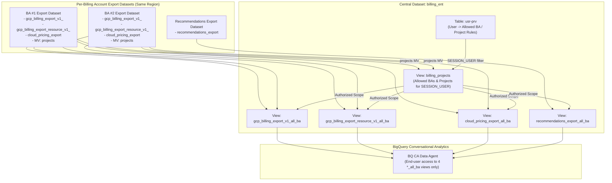
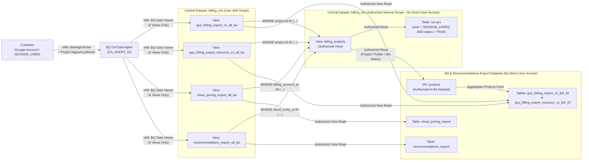

# Enterprise GCP Multi-Billing Account Conversational Analytics Agent (`billing_ent_agent`)

An enterprise FinOps & Cloud Billing analytics solution powered by the **BigQuery Conversational Analytics (BQ CA) Agent**. This project consolidates billing, resource usage, cloud pricing, and optimization recommendations across **multiple GCP Billing Accounts** into a unified, row-level secured analytical layer (`billing_ent`) and provisions a BigQuery Data Agent capable of answering natural language questions.

---

## Architecture Overview

All BigQuery billing export datasets and the central `billing_ent` dataset reside in the **same BigQuery region**. User access is dynamically governed via BigQuery `SESSION_USER()` mapped against a privileges table (`usr-prv`).



---

## BigQuery Data Model & Security Model

### 1. Per-Billing Account Export Datasets
Each Billing Account (`<BA>`) has its standard BigQuery export dataset containing:
- `gcp_billing_export_v1_<BA>`: Standard usage cost export.
- `gcp_billing_export_resource_v1_<BA>`: Detailed resource-level usage and cost export.
- `cloud_pricing_export`: Cloud Billing pricing export for SKU list/contract prices.
- **`projects` (Materialized View)**: Created in **each** Billing Account export dataset to maintain an up-to-date list of all GCP projects (`project_id`, `project_number`, `ancestry_numbers`, `billing_account_id`) belonging to that Billing Account.

### 2. Central Enterprise Dataset (`billing_ent`)
Created in the same region as all Billing Account export datasets:
- **`usr-prv` (Table)**: Stores user access control mappings (`date`, `user`, `project_id`, `obj_number`, `billing_id`, `status`). Each customer/user can have one or more availability records (`project_id`, folder `obj_number`, or `billing_id`). Setting `status = FALSE` (with `date` updated to the timestamp of the last change) temporarily disables the user's records.
- **`billing_projects` (Internal Helper View)**: Resolves the list of `(PROJECT, project_number, billing_account_id)` allowed for the current `SESSION_USER()` where `status = TRUE` by joining the per-BA `projects` materialized views with `usr-prv`.
- **4 End-User Analytical Views (Exposed to BQ CA Agent & End Users)**:
  1. **`gcp_billing_export_v1_all_ba` (View)**: Unified standard billing export view across all Billing Accounts, filtered by `billing_projects`, with column and nested `RECORD` descriptions applied from `json/billing_export_schema.json`.
  2. **`gcp_billing_export_resource_v1_all_ba` (View)**: Unified detailed resource billing export view across all Billing Accounts, filtered by `billing_projects`, with column and nested `RECORD` descriptions applied from `json/billing_export_resource_schema.json`.
  3. **`cloud_pricing_export_all_ba` (View)**: Unified pricing export view across Billing Accounts, filtered by `billing_projects`, with column and nested `RECORD` descriptions applied from `json/cloud_pricing_export_schema.json`.
  4. **`recommendations_export_all_ba` (View)**: Unified GCP Active Assist / Recommender export view (`recommendations_export`), filtered by `billing_projects`, with column and nested `RECORD` descriptions applied from `json/recommendations_export_schema.json`.

### 3. Security & Authorized Views Architecture
- **End-User IAM (`scripts/user_add.sh`)**: When onboarding an end user (`status = TRUE`), `scripts/user_add.sh` grants:
  1. **`roles/bigquery.dataViewer` on the 4 `*_all_ba` views ONLY** (`gcp_billing_export_v1_all_ba`, `gcp_billing_export_resource_v1_all_ba`, `cloud_pricing_export_all_ba`, `recommendations_export_all_ba`). Users do **not** have direct read access to `usr-prv`, `billing_projects`, or the underlying Billing Account / Recommendations export datasets.
  2. **`roles/bigquery.jobUser` on the host project (`${PROJECT_ID}`)** so the user can execute BigQuery query jobs initiated by the agent (does not grant read access to any datasets or tables).
  3. **`roles/geminidataanalytics.dataAgentUser` on the BQ CA Data Agent (`${CA_AGENT_ID}`)** so the user can access and chat with the agent.
- **Dataset Authorized Views (`scripts/03_create_ent_views.sh`)**:
  - **Each Billing Account Export Dataset** authorizes: MV `projects` (in that BA dataset) and views `billing_projects`, `gcp_billing_export_v1_all_ba`, `gcp_billing_export_resource_v1_all_ba`, and `cloud_pricing_export_all_ba` (in `billing_ent`).
  - **Each Recommendations Export Dataset** authorizes: views `billing_projects` and `recommendations_export_all_ba` (in `billing_ent`).
  - **Central `billing_ent` Dataset** authorizes: `billing_projects` and the 4 `*_all_ba` views so view-level queries can read `billing_projects` and `usr-prv`.



---

## Project Structure

```text
billing_ent_agent/
├── README.md                                        # Project overview & documentation
├── config/
│   └── config.env.example                           # Environment & multi-BA configuration template
├── json/                                            # BigQuery field description schemas & Verified Queries for BQ CA Agent
│   ├── billing_export_schema.json                   # Column & nested field descriptions for standard billing view
│   ├── billing_export_resource_schema.json          # Column & nested field descriptions for resource billing view
│   ├── cloud_pricing_export_schema.json             # Column & nested field descriptions for cloud pricing view
│   ├── recommendations_export_schema.json           # Column & nested field descriptions for recommendations view
│   └── golden_queries.md                            # Verified Queries (exampleQueries) for BQ CA Agent
├── sql/                                             # SQL templates for MVs, tables, and views
│   ├── table_usr_prv.sql.tmpl                       # DDL for billing_ent.`usr-prv` table
│   ├── usr_prv_schema.json                          # JSON schema for billing_ent.`usr-prv` table
│   ├── mv_projects.sql.tmpl                         # DDL for per-BA `projects` Materialized View
│   ├── view_billing_projects.sql.tmpl               # DDL for billing_ent.billing_projects view
│   ├── view_gcp_billing_export_v1_all_ba.sql.tmpl   # Per-BA SELECT template for unified standard billing view
│   ├── view_gcp_billing_export_resource_v1_all_ba.sql.tmpl # Per-BA SELECT template for unified resource billing view
│   ├── view_cloud_pricing_export_all_ba.sql.tmpl    # Per-BA SELECT template for unified cloud pricing view
│   └── view_recommendations_export_all_ba.sql.tmpl  # Per-source SELECT template for unified recommendations view
├── agent/
│   ├── system_instructions.md                       # System instructions & FinOps context for BQ CA Agent
│   └── data_agent_payload.json.tmpl                 # Conversational Analytics API DataAgent definition
└── scripts/
    ├── common.sh                                    # Shared helpers, config loader, schema merger & IAM/Authorized View helpers
    ├── 01_create_datasets_and_tables.sh             # Creates billing_ent dataset and usr-prv table
    ├── 02_create_ba_materialized_views.sh           # Creates `projects` MV in each BA export dataset
    ├── 03_create_ent_views.sh                       # Creates views in billing_ent & configures dataset Authorized Views
    ├── 04_provision_bq_ca_agent.sh                  # Creates/updates the BQ Conversational Analytics Agent (with Verified Queries)
    ├── user_add.sh                                  # Onboards, disables, enables, or deletes users (view/project/agent IAM & usr-prv)
    └── setup_all.sh                                 # Runs the full provisioning pipeline (01 -> 04)
```

---

## Quick Start & Usage

### Prerequisites
- `gcloud` CLI and `bq` CLI installed and authenticated (`gcloud auth login`).
- Permissions to create datasets/tables/views in the host project and create Materialized Views / update Authorized Views in the Billing Account export datasets.
- IAM roles for BigQuery Conversational Analytics:
  - `roles/geminidataanalytics.dataAgentCreator`
  - `roles/cloudaicompanion.user`
  - `roles/bigquery.dataViewer` & `roles/bigquery.jobUser`

---

## Table Availability Verification & Enabling Required BigQuery Export Tables

During installation (`./scripts/setup_all.sh`, `./scripts/02_create_ba_materialized_views.sh`, `./scripts/03_create_ent_views.sh`, and `./scripts/04_provision_bq_ca_agent.sh`), the scripts automatically verify the availability and accessibility of all configured source tables:

1. **Mandatory Table (`gcp_billing_export_v1_<BA>`)**:
   - Checked in every configured Billing Account dataset (`<BA_PROJECT_ID>:<BA_DATASET>.gcp_billing_export_v1_<BA_ID>`).
   - **If `gcp_billing_export_v1_<BA>` is missing or inaccessible for any Billing Account, the installation process halts immediately (`exit 1`) and returns an error.**
2. **Other Export Tables (`gcp_billing_export_resource_v1_<BA>`, `cloud_pricing_export`, `recommendations_export`)**:
   - Checked in each configured Billing Account / Recommendations dataset.
   - **If any of these tables are missing or inaccessible, the installer logs a `[Warning] Action Recommended: Please create/enable ... Without this table the agent answers will be less informative.` message advising the customer to follow the procedure below**, includes only the available tables in the `UNION ALL` views, and demonstrates the exact `SELECT` statements to be used in the views during `--preview` mode.

### Procedure to Enable Required BigQuery Export Tables

If the installation reports a missing table, follow these steps in the Google Cloud Console to enable the corresponding export into your BigQuery dataset (must be in the **same region**, e.g., `US`, as `billing_ent`):

1. **Standard Usage Cost Export (`gcp_billing_export_v1_<BA>`) — *Mandatory***
   - Open **Google Cloud Console → Billing → Billing export** ([https://console.cloud.google.com/billing/export](https://console.cloud.google.com/billing/export)).
   - Select your Billing Account.
   - Under **BigQuery export → Standard usage cost**, click **Edit settings**.
   - Select the target **Project** and **Dataset** configured in `BILLING_ACCOUNTS` and click **Save**.
   - Reference: [Set up Cloud Billing data export to BigQuery](https://cloud.google.com/billing/docs/how-to/export-data-bigquery-setup).

2. **Detailed Usage Cost Export (`gcp_billing_export_resource_v1_<BA>`)**
   - Open **Google Cloud Console → Billing → Billing export** ([https://console.cloud.google.com/billing/export](https://console.cloud.google.com/billing/export)).
   - Under **BigQuery export → Detailed usage cost**, click **Edit settings**.
   - Select the same target **Project** and **Dataset** configured for that Billing Account and click **Save**.

3. **Cloud Billing Pricing Export (`cloud_pricing_export`)**
   - Enable the **BigQuery Data Transfer Service API** (`bigquerydatatransfer.googleapis.com`) in the target project.
   - Open **Google Cloud Console → Billing → Billing export** ([https://console.cloud.google.com/billing/export](https://console.cloud.google.com/billing/export)).
   - Under **BigQuery export → Pricing**, click **Edit settings**, select the target **Project** and **Dataset**, and click **Save**.
   - Reference: [Enable Pricing export in Cloud Billing](https://cloud.google.com/billing/docs/how-to/export-data-bigquery-setup#pricing-data).

4. **Active Assist Recommendations Export (`recommendations_export`)**
   - Enable the **BigQuery Data Transfer Service API** (`bigquerydatatransfer.googleapis.com`) and **Recommender API** (`recommender.googleapis.com`).
   - Open **Google Cloud Console → BigQuery → Data transfers** ([https://console.cloud.google.com/bigquery/transfers](https://console.cloud.google.com/bigquery/transfers)).
   - Click **+ Create transfer**, select **Google Cloud Recommendations** as the Source type, choose the Organization scope, set the target **Dataset** configured in `RECOMMENDATIONS_SOURCES`, and click **Save**.
   - Reference: [Export recommendations to BigQuery](https://cloud.google.com/recommender/docs/bq-export/export-recommendations-to-bq).

> After enabling any missing export tables and waiting for the initial export table creation in BigQuery, re-run `./scripts/03_create_ent_views.sh` and `./scripts/04_provision_bq_ca_agent.sh` (or `./scripts/setup_all.sh`).

---

### Step 1: Configure Environment
Copy the example configuration and populate your project, region, Billing Account details, and `CA_AGENT_ID` (keeping `CA_AGENT_DISPLAY_NAME="Enterprise Multi-BA FinOps & Billing Agent"`):
```bash
cp config/config.env.example config/config.env
```

### Step 2: Provide / Customize SQL Templates & Golden Queries
Place or update the SQL templates inside `sql/` and Verified Queries (`exampleQueries`) inside `json/golden_queries.md`.

### Step 3: Preview or Run Provisioning Scripts
All scripts support `--preview` (or `-p` / `preview`) to print all rendered BigQuery DDL statements, `bq` CLI commands, and REST API payloads without executing them, as well as `--agent-id <agent_id>` (or `-a <agent_id>`) to override `CA_AGENT_ID`:
```bash
# Preview all commands and rendered SQL without running them:
./scripts/setup_all.sh --preview

# Or preview individual steps:
./scripts/01_create_datasets_and_tables.sh --preview
./scripts/02_create_ba_materialized_views.sh --preview
./scripts/03_create_ent_views.sh --preview
./scripts/04_provision_bq_ca_agent.sh --preview
```

When ready to execute against GCP:
```bash
# Run individual steps:
./scripts/01_create_datasets_and_tables.sh
./scripts/02_create_ba_materialized_views.sh
./scripts/03_create_ent_views.sh
./scripts/04_provision_bq_ca_agent.sh

# Or run all steps sequentially:
./scripts/setup_all.sh
```

### Step 4: Onboard, Disable, Enable, or Delete End Users (`scripts/user_add.sh`)
Use `scripts/user_add.sh` to manage user IAM bindings and availability records in `${PROJECT_ID}.${ENT_DATASET}.usr-prv`:

- **Permissions Granted on User Add / Enable (`--status true`)**:
  1. `roles/bigquery.dataViewer` on the **4 `*_all_ba` views only** (`gcp_billing_export_v1_all_ba`, `gcp_billing_export_resource_v1_all_ba`, `cloud_pricing_export_all_ba`, `recommendations_export_all_ba`).
  2. `roles/bigquery.jobUser` on the **host project** (`${PROJECT_ID}`).
  3. `roles/geminidataanalytics.dataAgentUser` on the **BQ CA Data Agent** (`${CA_AGENT_ID}`).
- **Automatic Billing Account ID Normalization**:
  - `--billing-account` (and the BA segment of `--record`) automatically normalizes underscore-separated (`xxxxxx_xxxxx_xxxxxx` / `xxxxxx_xxxxxx_xxxxxx`) or unseparated (`xxxxxxxxxxxxxxxxx` / `xxxxxxxxxxxxxxxxxx`) Billing Account IDs to hyphenated format (`xxxxxx-xxxxx-xxxxxx` / `xxxxxx-xxxxxx-xxxxxx`) to match BigQuery billing export data.

```bash
# Add a user with multiple availability records (projects, folders, or billing accounts):
./scripts/user_add.sh --user alice@example.com \
  --project my-project-1 --project my-project-2 \
  --folder 123456789012 \
  --billing-account 012345-6789AB-CDEF01

# Billing Account IDs with underscores or no separators are automatically normalized:
./scripts/user_add.sh --user alice@example.com --billing-account 012345_6789AB_CDEF01

# Preview the IAM bindings and MERGE SQL without executing:
./scripts/user_add.sh --user alice@example.com --project my-project-1 --preview

# Temporarily disable all records for a user (sets status=FALSE and updates date=CURRENT_TIMESTAMP()):
./scripts/user_add.sh --user alice@example.com --disable

# Re-enable a user (sets status=TRUE and updates date=CURRENT_TIMESTAMP()):
./scripts/user_add.sh --user alice@example.com --enable

# Delete a user completely (removes all rows from usr-prv, revokes BQ Data Viewer from all 4 views,
# and revokes roles/geminidataanalytics.dataAgentUser from the Data Agent):
./scripts/user_add.sh --user alice@example.com --delete
```
