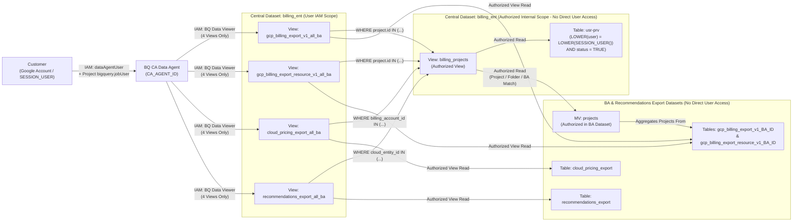

# Enterprise GCP Multi-Billing Account Conversational Analytics Agent (`billing_ent_agent`)

> **Evolution of [`gcp-billing-agent`](https://github.com/tytskov-tech/gcp-billing-agent):** This project is the next-generation, enterprise multi-Billing Account evolution of [`gcp-billing-agent`](https://github.com/tytskov-tech/gcp-billing-agent). While the original agent connects BigQuery Conversational Analytics to a single Billing Account export dataset, **`billing_ent_agent`** consolidates **multiple GCP Billing Accounts and Organizations** behind a unified, row-level secured analytical layer (`billing_ent`) with automated provisioning and multi-tenant user access governance.
>
> 📖 **For step-by-step setup, deployment, user management, and Gemini Enterprise A2A integration, see [INSTALLATION.md](INSTALLATION.md).**

---

## Bridging the Gap Between Engineering and Finance: Talking Directly to Your AI-Driven Enterprise GCP Billing

Cloud financial management (FinOps) has a notorious communication gap.

Engineers live in the Google Cloud Console, developing and tracking architecture changes and infrastructure optimization metrics. Finance, revenue, and procurement teams live in spreadsheets, trying to map raw line-item costs back to business units. When an unexpected spike in cloud spend happens, they email Engineering. Engineering digs through the GCP console, writes complex BigQuery SQL queries against billing exports, cross-references them with pricing tables, and eventually realizes a developer left a cluster of GPUs running after a weekend experiment.

The process takes hours, sometimes days. By the time the anomaly is found, the money is spent.

The detection of cloud spend anomalies also represents a critical link between **FinOps** and **SecOps**. While sudden cost fluctuations often highlight inefficiencies or misconfigurations, they are equally indicative of security incidents such as resource hijacking or data exfiltration. The resulting investigation usually involves a high volume of emails, ad-hoc dashboard creation, and delayed answers.

What if your finance, procurement, engineering, and security teams could simply ask your data for the answers—across **all** of your enterprise Billing Accounts—while strictly seeing only the projects, folders, or Billing Accounts they are authorized to access?

* *"Why did our BigQuery costs spike by 20% last Tuesday across our production projects?"*
* *"What are our top three infrastructure cost-saving recommendations this month, and which projects do they belong to?"*
* *"Compare our effective discounted SKU prices against public list prices for Compute Engine in `us-central1`."*

The core challenge of FinOps isn’t a lack of data—it’s **secure data accessibility**. Cloud billing exports, pricing APIs, and sizing recommendations generate massive amounts of telemetry across multiple Billing Accounts and organizations. Raw BigQuery tables are inaccessible to financial analysts who don't write SQL, and static dashboards (like Looker or Grafana) are rigid—the moment an analyst has a question outside predefined filters, they are back to filing a ticket for the data engineering team.

---

## The Solution: An Enterprise Multi-Billing Account Conversational FinOps Agent

A **BigQuery Conversational Analytics (BQ CA) Agent** is an AI-powered bridge between human language and complex cloud data. Instead of requiring a user to know database schemas or SQL syntax, the agent acts as a bilingual translator: it takes a question asked in natural language, translates that intent into optimized BigQuery SQL, executes the query against the data warehouse under the requesting user's identity (`SESSION_USER()`), and translates the resulting rows and columns back into a natural, conversational response.

[For background and examples on the foundational single-account agent, read the Medium article](https://medium.com/google-cloud/cloud-financial-management-finops-has-a-notorious-communication-gap-5203dcefa878) and visit [`gcp-billing-agent`](https://github.com/tytskov-tech/gcp-billing-agent).

### What's New in the Enterprise Edition (`billing_ent_agent`)

1. **Multi-Billing Account & Multi-Organization Consolidation**
   - Unifies Standard Usage Cost Exports (`gcp_billing_export_v1_<BA>`), Detailed Resource-Level Exports (`gcp_billing_export_resource_v1_<BA>`), Cloud Pricing Exports (`cloud_pricing_export`), and Active Assist Recommendations (`recommendations_export`) from any number of Billing Accounts and organizations into **4 central analytical views** (`*_all_ba`).
2. **Dynamic Row-Level Security via `SESSION_USER()` & Authorized Views**
   - Access is governed dynamically at query runtime via a central privileges table (`usr-prv`) and helper view (`billing_projects`).
   - Users can be scoped to specific **GCP Projects** (`project_id`), **GCP Folders** (`obj_number` matched against `project.ancestry_numbers`), specific **Billing Accounts** (`billing_id`), or **`ALL`** Billing Accounts.
   - End users only receive `roles/bigquery.dataViewer` on the 4 unified `*_all_ba` views—never on the underlying Billing Account datasets, `usr-prv`, or `billing_projects`.
3. **Automated End-to-End Provisioning & Preflight Verification**
   - Bash automation (`scripts/setup_all.sh`, `01`–`04`) verifies source table availability, builds per-BA Materialized Views (`projects`), constructs `UNION ALL` enterprise views from available tables, merges FinOps column descriptions into nested BigQuery `RECORD` schemas, configures cross-dataset Authorized Views, and provisions the BQ CA Data Agent via REST API with System Instructions and Verified Queries (`json/golden_queries.md`).
4. **Full End-User Lifecycle CLI (`scripts/user_add.sh`)**
   - Single-command onboarding, temporary disabling (`--disable`), re-enabling (`--enable`), and complete removal (`--delete`) of end users across BigQuery view IAM, host project `bigquery.jobUser`, Data Agent `dataAgentUser`, and `usr-prv` privilege records, including automatic Billing Account ID normalization (`xxxxxx_xxxxx_xxxxxx` / `xxxxxxxxxxxxxxxxx` → `xxxxxx-xxxxx-xxxxxx`).

---

## Architecture Overview

All BigQuery billing export datasets and the central `billing_ent` dataset reside in the **same BigQuery region**. User access is dynamically governed via BigQuery `SESSION_USER()` mapped against a privileges table (`usr-prv`).


---

## BigQuery Data Model & Security Model

### 1. Per-Billing Account Export Datasets
Each Billing Account (`<BA>`) has its standard BigQuery export dataset containing:
- `gcp_billing_export_v1_<BA>`: Standard usage cost export (*Mandatory*).
- `gcp_billing_export_resource_v1_<BA>`: Detailed resource-level usage and cost export.
- `cloud_pricing_export`: Cloud Billing pricing export for SKU list and contract prices.
- **`projects` (Materialized View)**: Created in **each** Billing Account export dataset to maintain an up-to-date list of all GCP projects (`project_id`, `project_number`, `ancestry_numbers`, `billing_account_id`) belonging to that Billing Account.

### 2. Central Enterprise Dataset (`billing_ent`)
Created in the same region as all Billing Account export datasets:
- **`usr-prv` (Table)**: Stores user access control mappings (`date`, `user`, `project_id`, `obj_number`, `billing_id`, `status`). Each user can have one or more availability records (`project_id`, folder `obj_number`, or `billing_id`). Setting `status = FALSE` (with `date` updated to the timestamp of the last change) temporarily disables the user's records.
- **`billing_projects` (Internal Helper View)**: Resolves the list of `(PROJECT, project_number, billing_account_id)` allowed for the current `SESSION_USER()` where `status = TRUE` by joining the per-BA `projects` materialized views with `usr-prv`.
- **4 End-User Analytical Views (Exposed to BQ CA Agent & End Users)**:
  1. **`gcp_billing_export_v1_all_ba` (View)**: Unified standard billing export view across all Billing Accounts, filtered by `billing_projects`, with column and nested `RECORD` descriptions applied from `json/billing_export_schema.json`.
  2. **`gcp_billing_export_resource_v1_all_ba` (View)**: Unified detailed resource billing export view across all Billing Accounts, filtered by `billing_projects`, with column and nested `RECORD` descriptions applied from `json/billing_export_resource_schema.json`.
  3. **`cloud_pricing_export_all_ba` (View)**: Unified pricing export view across Billing Accounts, filtered by `billing_projects`, with column and nested `RECORD` descriptions applied from `json/cloud_pricing_export_schema.json`.
  4. **`recommendations_export_all_ba` (View)**: Unified GCP Active Assist / Recommender export view (`recommendations_export`), filtered by `billing_projects`, with column and nested `RECORD` descriptions applied from `json/recommendations_export_schema.json`.

### 3. Security & Authorized Views Architecture
- **End-User IAM (`scripts/user_add.sh`)**: When onboarding an end user (`status = TRUE`), `scripts/user_add.sh` grants:
  1. **`roles/bigquery.dataViewer` on the 4 `*_all_ba` views ONLY** (`gcp_billing_export_v1_all_ba`, `gcp_billing_export_resource_v1_all_ba`, `cloud_pricing_export_all_ba`, `recommendations_export_all_ba`). Users do **not** have direct read access to `usr-prv`, `billing_projects`, or the underlying Billing Account / Recommendations export datasets.
  2. **`roles/bigquery.jobUser` on the host project (`${PROJECT_ID}`)** so the user can execute BigQuery query jobs initiated by the agent (does not grant read access to any datasets or tables).
  3. **`roles/geminidataanalytics.dataAgentUser` on the BQ CA Data Agent (`${CA_AGENT_ID}`)** so the user can access and chat with the agent.
- **Dataset Authorized Views (`scripts/03_create_ent_views.sh`)**:
  - **Each Billing Account Export Dataset** authorizes: MV `projects` (in that BA dataset) and views `billing_projects`, `gcp_billing_export_v1_all_ba`, `gcp_billing_export_resource_v1_all_ba`, and `cloud_pricing_export_all_ba` (in `billing_ent`).
  - **Each Recommendations Export Dataset** authorizes: views `billing_projects` and `recommendations_export_all_ba` (in `billing_ent`).
  - **Central `billing_ent` Dataset** authorizes: `billing_projects` and the 4 `*_all_ba` views so view-level queries can read `billing_projects` and `usr-prv`.



---

## Project Structure

```text
billing_ent_agent/
├── README.md                                        # Project overview, FinOps solution & architecture
├── INSTALLATION.md                                  # Step-by-step installation, user management & Gemini Enterprise guide
├── config/
│   └── config.env.example                           # Environment & multi-BA configuration template
├── json/                                            # BigQuery field description schemas, Instructions & Verified Queries
│   ├── agent_instructions.md                        # System instructions & FinOps context for BQ CA Agent
│   ├── golden_queries.md                            # Verified Queries (exampleQueries) for BQ CA Agent
│   ├── billing_export_schema.json                   # Column & nested field descriptions for standard billing view
│   ├── billing_export_resource_schema.json          # Column & nested field descriptions for resource billing view
│   ├── cloud_pricing_export_schema.json             # Column & nested field descriptions for cloud pricing view
│   └── recommendations_export_schema.json           # Column & nested field descriptions for recommendations view
├── sql/                                             # SQL templates for MVs, tables, and views
│   ├── table_usr_prv.sql.tmpl                       # DDL for billing_ent.`usr-prv` table
│   ├── usr_prv_schema.json                          # JSON schema for billing_ent.`usr-prv` table
│   ├── mv_projects.sql.tmpl                         # DDL for per-BA `projects` Materialized View
│   ├── view_billing_projects.sql.tmpl               # DDL for billing_ent.billing_projects view
│   ├── view_gcp_billing_export_v1_all_ba.sql.tmpl   # Per-BA SELECT template for unified standard billing view
│   ├── view_gcp_billing_export_resource_v1_all_ba.sql.tmpl # Per-BA SELECT template for unified resource billing view
│   ├── view_cloud_pricing_export_all_ba.sql.tmpl    # Per-BA SELECT template for unified cloud pricing view
│   └── view_recommendations_export_all_ba.sql.tmpl  # Per-source SELECT template for unified recommendations view
├── agent/
│   ├── system_instructions.md                       # Fallback system instructions template
│   └── data_agent_payload.json.tmpl                 # Conversational Analytics API DataAgent definition
└── scripts/
    ├── common.sh                                    # Shared helpers, config loader, schema merger & IAM/Authorized View helpers
    ├── 01_create_datasets_and_tables.sh             # Creates billing_ent dataset and usr-prv table
    ├── 02_create_ba_materialized_views.sh           # Creates `projects` MV in each BA export dataset
    ├── 03_create_ent_views.sh                       # Creates views in billing_ent & configures dataset Authorized Views
    ├── 04_provision_bq_ca_agent.sh                  # Creates/updates the BQ Conversational Analytics Agent (with Verified Queries)
    ├── user_add.sh                                  # Onboards, disables, enables, or deletes users (view/project/agent IAM & usr-prv)
    └── setup_all.sh                                 # Runs the full provisioning pipeline (01 -> 04)
```

---

## Getting Started

Ready to deploy the Enterprise Multi-Billing Account Agent and connect it to Gemini Enterprise?

👉 **[Proceed to the Installation Guide (`INSTALLATION.md`)](INSTALLATION.md)**
